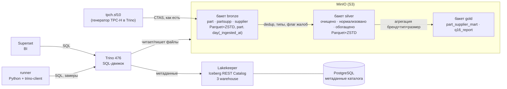

# Локальный Lakehouse: ELT по медальону и бенчмарк форматов/сжатия (TPC-H Q16)

Практическая работа №1 · VK Education · НИТУ МИСИС, осень 2026
**Степанова Самира Сергеевна**, группа БИВТ-24-СП-4, **вариант 4 — TPC-H Q16** («Parts/Supplier Relationship»)

📄 **Отчёт с результатами и обоснованиями — [REPORT.md](REPORT.md)** (заполняется автоматически по реальным замерам).

---

## Что сделано

| Требование | Где |
|---|---|
| Развёрнут локальный Lakehouse (MinIO* + PostgreSQL + Lakekeeper Iceberg REST + Trino) | `docker-compose.yml`, `catalog/`, `init/` |
| Загрузка сырых данных → **Bronze** | `sql/01_bronze.sql` |
| Очистка, нормализация, обогащение → **Silver** | `sql/02_silver.sql` |
| Агрегированная витрина для BI → **Gold** + проверка корректности против Q16 | `sql/03_gold.sql`, `sql/04_q16.sql` |
| Бенчмарк: размер, время записи, скорость агрегаций для 2 форматов × 4 кодеков | `runner/lakehouse.py bench`, `results/` |
| Time travel и восстановление из снапшота, schema evolution | `sql/05_time_travel.sql`, `sql/06_schema_evolution.sql` |
| BI-инструмент поверх lakehouse (Superset) | `superset/`, раздел 6.2 отчёта |
| Методология и выводы | этот README + [REPORT.md](REPORT.md) |

\* MinIO с сентября 2026 не публикует образы (`quay.io/minio/minio` → 401), поэтому используется
совместимая community-сборка `pgsty/silo` (тот же MinIO, тот же S3 API и консоль), а бакеты создаются
скриптом `init/create-warehouses.sh` через S3 API (curl с подписью SigV4) вместо образа `mc`.

## Архитектура



Каждый слой — **отдельный бакет MinIO + отдельный warehouse Lakekeeper + отдельный каталог Trino**
(`bronze`, `silver`, `gold`), как в гайде 2. Таблица в Trino всегда называется `каталог.схема.таблица`,
например `silver.lakehouse.partsupp`.

## Как запустить (≈ 20–30 минут, из них ~5 — скачивание образов)

**Нужно:** Docker Desktop, выделено **не меньше 6 ГБ памяти** (Settings → Resources; на Windows с WSL2 — по умолчанию
половина RAM компьютера), ~10 ГБ свободного места. Python на компьютере **не нужен** — всё работает в контейнерах.

> Если раньше поднимала стек по гайду командами `docker run` — сначала удали старые контейнеры (порты и имена совпадают):
> `docker rm -f trino lakekeeper lakehouse-pg lakehouse-minio`

```bash
# 0. перейти в папку репозитория
cd lakehouse-q16

# 1. поднять весь стек (MinIO + бакеты, Postgres, Lakekeeper + 3 warehouse, Trino)
docker compose up -d
docker ps                                   # trino должен стать (healthy) через ~30 с

# 2. весь пайплайн: Bronze -> Silver -> Gold -> проверки -> бенчмарк -> time travel -> evolution -> REPORT.md
docker compose run --rm runner python runner/lakehouse.py all

# 3. BI (раздел 6.2 отчёта): http://localhost:8088  логин admin / пароль admin
docker compose --profile bi up -d superset
```

Шаги можно запускать по отдельности: `... lakehouse.py bronze silver gold validate layers bench timetravel evolution report`.
Результаты копятся в `results/results.json`, после любого шага можно перестроить отчёт: `... lakehouse.py report`.

На Windows то же самое делает `scripts\run_all.ps1`, на macOS/Linux — `scripts/run_all.sh`.

| Сервис | Адрес | Логин / пароль |
|---|---|---|
| MinIO консоль | http://localhost:9001 | minioadmin / minioadmin |
| Lakekeeper UI | http://localhost:8181/ui | — |
| Trino UI | http://localhost:8080 | любой / пусто |
| Superset | http://localhost:8088 | admin / admin |
| DBeaver → Trino | `jdbc:trino://localhost:8080` | trino / пусто |

## Методология (кратко; подробно — в REPORT.md)

**Данные.** Источник — встроенный в Trino генератор TPC-H (`tpch.sf10`, колонки в стандартном именовании
`p_partkey…`). Q16 нужны только `part`, `partsupp`, `supplier` (8 колонок из 21) — остальные 5 таблиц не загружаются.

**Медальон.**

* **Bronze** — копия источника без изменений + `_ingested_at`, `_source`; append-only; партиция по дню загрузки.
* **Silver** — очистка (NULL-ключи, дубликаты через `row_number()`, диапазоны, ссылочная целостность),
  нормализация (`trim/upper`, деньги в `decimal(12,2)`, разбор `p_type` на 3 атрибута), обогащение
  (флаг `s_has_complaints` вместо текста `s_comment`, `ps_stock_value`), удаление тяжёлого текста и контактов.
* **Gold** — `part_supplier_mart`: куб по бренд × тип × размер с числом поставщиков без жалоб (метрика Q16) и
  доп. метриками; отвечает на Q16 с любыми параметрами простым `WHERE`. `q16_report` — готовый ответ Q16.
* **Корректность:** ответ канонического Q16 по сырому Bronze и ответ из Gold сравниваются `EXCEPT` в обе стороны;
  плюс сверка с контрольными значениями, посчитанными независимо (DuckDB на данных dbgen-совместимого генератора):
  для sf10 — 27 840 строк, сумма `supplier_cnt` = 1 186 339, 56 поставщиков с жалобами; для sf1 — 18 314 строк
  (совпадает с эталонным ответом спецификации TPC-H).

**Бенчмарк.**

* 8 вариантов: `PARQUET`/`ORC` × `NONE`/`SNAPPY`/`GZIP`/`ZSTD`. Кодек — сессионное свойство `bronze.compression_codec`,
  формат — свойство таблицы `format`.
* Для каждого варианта Bronze пересоздаётся CTAS-копией из одного и того же источника (`bronze.lakehouse.*`) —
  в «время записи» входит одинаковое чтение + кодирование/сжатие/выгрузка в MinIO.
* **Размер** — `sum(file_size_in_bytes)` из `"<таблица>$files"`.
* **Скорость агрегаций** — два запроса: Q16 (джойн, `count(DISTINCT)`, `NOT IN`, читает узкие колонки) и
  full scan `partsupp` (читает все колонки, включая текст).
* **Время** — серверное `end − created` из `system.runtime.queries`; 1 прогрев + 5 замеров, **медиана**, min–max, σ.
  Все 8 вариантов обязаны дать одинаковый ответ Q16 (контрольная сумма).
* Выбор кодека для слоёв — по взвешенной оценке (метрики нормированы на лучший вариант), веса разные для
  «пишем раз — храним долго» (Bronze) и «читаем постоянно» (Silver/Gold).

## Структура

```
docker-compose.yml          весь стек + runner + superset
.env                        SF=sf10, BENCH_RUNS=5
catalog/                    каталоги Trino: bronze/silver/gold (Iceberg REST) + tpch
init/create-warehouses.sh   Terms of Use + 3 warehouse в Lakekeeper (идемпотентно)
sql/
  00_schemas.sql            схемы
  01_bronze.sql             сырой слой
  02_silver.sql             очистка / нормализация / обогащение
  03_gold.sql               витрины
  04_q16.sql                Q16 по трём слоям + проверка совпадения
  05_time_travel.sql        восстановление из снапшота (для DBeaver)
  06_schema_evolution.sql   эволюция схемы (для DBeaver)
runner/
  lakehouse.py              пайплайн, проверки, бенчмарк, time travel, evolution
  report.py                 графики + заполнение REPORT.md
  report_template.md        шаблон отчёта (форма преподавателя)
  Dockerfile                python + trino-client + matplotlib
superset/Dockerfile         Superset 4.1 + драйвер Trino
results/                    results.json, benchmark.csv, benchmark.png, layers_q16.png
docs/screenshots/           скриншоты UI (что снять — в docs/screenshots/README.md)
```

## Если что-то пошло не так

| Симптом | Что делать |
|---|---|
| `port is already allocated` | Остались контейнеры из гайда: `docker rm -f trino lakekeeper lakehouse-pg lakehouse-minio` |
| `Query exceeded per-node memory limit` / Trino упал | Дать Docker Desktop больше памяти (≥ 6–8 ГБ) или уменьшить масштаб: в `.env` поставить `SF=sf5` и запустить `all` заново |
| `lakekeeper-init` завершился с ошибкой | `docker compose logs lakekeeper-init lakekeeper` ; повторить `docker compose up -d` (скрипт идемпотентный) |
| Trino не видит каталог `bronze` | `docker exec trino trino --execute "SHOW CATALOGS"`; проверить, что в `catalog/` 4 файла и переносы строк LF |
| На Windows `/bin/sh^M: not found` | Git заменил переносы на CRLF. В репозитории есть `.gitattributes`; выполнить `git rm --cached -r . && git reset --hard` |
| Всё снести и начать заново | `docker compose --profile bi --profile tools down -v` |
