<p align="center">
Министерство науки и высшего образования Российской Федерации<br>
Федеральное государственное автономное образовательное учреждение высшего образования<br>
<b>«Национальный исследовательский технологический университет «МИСИС»</b><br>
Институт компьютерных наук<br>
Кафедра автоматизированных систем управления
</p>

<br>

<h2 align="center">ОТЧЁТ<br>по практической работе №1</h2>

<p align="center">
<b>«Развёртывание локального Lakehouse, ELT-преобразование<br>и бенчмарк форматов и сжатия»</b><br>
Вариант 4 — запрос TPC-H Q16 «Parts/Supplier Relationship»<br>
Дисциплина: VK Education · Л-826
</p>

<br>

| | |
|---|---|
| Выполнила | студентка группы БИВТ-24-СП-4 **Степанова Самира Сергеевна** |
| Проверил | Кривяков Александр Олегович |
| Стек | MinIO (Silo) + PostgreSQL + Lakekeeper (Iceberg REST) + Trino 476 + Superset |
| Дата прогона | 2026-10-17 17:37 МСК |
| Окружение | Docker Desktop: 12 vCPU, 7.4 ГБ RAM, 1 узел Trino |

<p align="center">Москва, 2026</p>

---

<h3 align="center">СОДЕРЖАНИЕ</h3>

- [ВВЕДЕНИЕ](#введение)
- [1. ЗАДАЧИ ЛАБОРАТОРНОЙ РАБОТЫ](#1-задачи-лабораторной-работы)
- [2. ТЕОРЕТИЧЕСКАЯ ЧАСТЬ](#2-теоретическая-часть)
  - [2.1. Lakehouse и медальонная архитектура](#21-lakehouse-и-медальонная-архитектура)
  - [2.2. Колоночные форматы Parquet и ORC](#22-колоночные-форматы-parquet-и-orc)
  - [2.3. Кодеки сжатия](#23-кодеки-сжатия)
  - [2.4. Apache Iceberg: метаданные, снапшоты и каталог](#24-apache-iceberg-метаданные-снапшоты-и-каталог)
  - [2.5. Trino и запрос TPC-H Q16](#25-trino-и-запрос-tpc-h-q16)
- [3. ПРАКТИЧЕСКАЯ ЧАСТЬ](#3-практическая-часть)
  - [3.1. Вариант и масштаб (п. 1 формы)](#31-вариант-и-масштаб-п-1-формы)
  - [3.2. Поднятые сервисы — и почему именно они (п. 2 формы)](#32-поднятые-сервисы--и-почему-именно-они-п-2-формы)
  - [3.3. Разбор запроса — какие данные нужны (п. 3 формы)](#33-разбор-запроса--какие-данные-нужны-п-3-формы)
  - [3.4. Медальон — решения по каждому слою (п. 4 формы)](#34-медальон--решения-по-каждому-слою-п-4-формы)
    - [3.4.1. Bronze (сырой) — бакет bronze](#341-bronze-сырой--бакет-bronze)
    - [3.4.2. Silver (очищенный) — бакет silver](#342-silver-очищенный--бакет-silver)
    - [3.4.3. Gold (витрина) — бакет gold](#343-gold-витрина--бакет-gold)
    - [3.4.4. Зачем нужен медальон — один вопрос, три слоя](#344-зачем-нужен-медальон--один-вопрос-три-слоя)
  - [3.5. Тесты производительности (п. 5 формы)](#35-тесты-производительности-п-5-формы)
    - [3.5.1. Методика](#351-методика)
    - [3.5.2. Таблица из формы (Parquet, Bronze)](#352-таблица-из-формы-parquet-bronze)
    - [3.5.3. Полный бенчмарк: 8 вариантов](#353-полный-бенчмарк-8-вариантов)
    - [3.5.4. Анализ](#354-анализ)
  - [3.6. Часть 2 — осмысление и работа с инструментами (п. 6 формы)](#36-часть-2--осмысление-и-работа-с-инструментами-п-6-формы)
    - [3.6.1. Понять и объяснить (п. 6.1 формы)](#361-понять-и-объяснить-п-61-формы)
    - [3.6.2. Подключить инструмент к lakehouse (п. 6.2 формы)](#362-подключить-инструмент-к-lakehouse-п-62-формы)
    - [3.6.3. Дополнительно: обслуживание таблиц и проблема мелких файлов](#363-дополнительно-обслуживание-таблиц-и-проблема-мелких-файлов)
- [ЗАКЛЮЧЕНИЕ (п. 7 формы)](#заключение-п-7-формы)
- [СПИСОК ЛИТЕРАТУРЫ](#список-литературы)
- [ПРИЛОЖЕНИЕ А. Скриншоты](#приложение-а-скриншоты)
- [ПРИЛОЖЕНИЕ Б. Структура репозитория](#приложение-б-структура-репозитория)

---

## ВВЕДЕНИЕ

Объёмы аналитических данных растут быстрее, чем возможности одного сервера с классической СУБД. Поэтому
индустрия переходит к архитектуре **Lakehouse**: данные лежат в дешёвом объектном хранилище в открытых
колоночных форматах, а транзакционность, схему и историю изменений обеспечивает табличный формат
(Apache Iceberg). Вычисления выполняет отдельный SQL-движок, который можно масштабировать независимо от хранения.

**Цель работы** — развернуть локальный Lakehouse, реализовать на нём полный ELT-цикл по медальонной
архитектуре (Bronze → Silver → Gold) для бизнес-вопроса варианта 4 (TPC-H Q16) и экспериментально
обосновать выбор формата файлов и кодека сжатия для каждого слоя.

**Объект исследования** — стек MinIO + Lakekeeper + Trino с таблицами Apache Iceberg.
**Предмет исследования** — влияние формата (Parquet, ORC) и кодека (NONE, SNAPPY, GZIP, ZSTD) на размер
данных, время записи и скорость аналитических запросов.

> Все числа в отчёте получены автоматически скриптом `runner/lakehouse.py` на этом стенде
> (сырые результаты — `results/results.json`). Методика замеров — в п. 3.5.

## 1. ЗАДАЧИ ЛАБОРАТОРНОЙ РАБОТЫ

1. Развернуть в Docker локальный Lakehouse: объектное хранилище, Iceberg REST-каталог, SQL-движок.
2. Загрузить сырые данные TPC-H (масштаб sf10), необходимые для запроса Q16, в слой **Bronze**.
3. Очистить, нормализовать и обогатить данные в слое **Silver**.
4. Построить агрегированную витрину для бизнес-аналитики в слое **Gold** и проверить её корректность против эталонного Q16.
5. Провести бенчмарк: размер файлов, время записи и скорость агрегаций для 2 форматов × 4 кодеков.
6. Продемонстрировать возможности Iceberg: time travel и восстановление из снапшота, эволюцию схемы, обслуживание таблиц.
7. Подключить к lakehouse BI-инструмент (Superset) и показать работу с Bronze и Gold.
8. Описать методологию, обосновать решения и опубликовать работу в GitHub.

## 2. ТЕОРЕТИЧЕСКАЯ ЧАСТЬ

### 2.1. Lakehouse и медальонная архитектура

Lakehouse = **объектное хранилище** (S3/MinIO) + **открытый табличный формат с ACID** (Iceberg) + **отделённый
движок** (Trino). В отличие от «просто файлов в data lake», у таблицы есть схема, транзакции и история; в отличие
от классического DWH, данные не заперты в формате одного продукта и к ним может подключиться любой совместимый
движок. Медальонная архитектура делит данные на слои по степени готовности: **Bronze** — сырые данные как из
источника (append-only), **Silver** — очищенные и приведённые к единой схеме, **Gold** — агрегаты под конкретные
бизнес-вопросы. Каждый следующий слой дороже построить, но дешевле и надёжнее читать.

### 2.2. Колоночные форматы Parquet и ORC

Оба формата хранят данные **по колонкам** блоками (row group в Parquet, stripe в ORC) и записывают статистику
min/max для каждого блока. Это даёт два эффекта: запрос читает только нужные колонки (**column pruning**) и
пропускает блоки, которые не могут пройти фильтр (**predicate pushdown**). Внутри колонки значения сначала
кодируются (словарь, RLE, delta), и только потом сжимаются кодеком. Parquet — де-факто стандарт экосистемы
Iceberg/Spark, ORC исторически развивался в экосистеме Hive.

### 2.3. Кодеки сжатия

* **NONE** — без сжатия: минимум CPU, максимум байт на диске и в сети.
* **SNAPPY** — LZ77 без энтропийного кодирования: очень быстрый, сжимает умеренно.
* **GZIP** (DEFLATE, RFC 1951) — LZ77 + коды Хаффмана: сжимает сильно, но медленно и при записи, и при чтении.
* **ZSTD** (RFC 8878) — LZ77 + энтропийное кодирование FSE/Хаффман: по степени сжатия близок к GZIP, по скорости
  распаковки — к SNAPPY. Кодек по умолчанию в Trino и Iceberg.

Выбор кодека — это компромисс «CPU ↔ байты»: в облачном S3 байты стоят денег и времени передачи, поэтому сильное и
быстрое сжатие обычно выгоднее.

### 2.4. Apache Iceberg: метаданные, снапшоты и каталог

Таблица Iceberg — это дерево метаданных: `metadata.json` (схема, партиционирование, список снапшотов) →
manifest list снапшота → манифесты → файлы данных. Каждая запись (INSERT, DELETE, UPDATE, `optimize`) создаёт
**новый снапшот**, не изменяя старые файлы, поэтому возможны **time travel** (`FOR VERSION AS OF`) и мгновенный
откат (`rollback_to_snapshot`). Колонки идентифицируются по числовому id, поэтому добавление и переименование
колонок не требуют перезаписи данных (**schema evolution**). Атомарность обеспечивает **каталог**: он хранит
указатель на текущий `metadata.json` и меняет его транзакционно. В работе используется Lakekeeper — реализация
открытого стандарта **Iceberg REST Catalog** с метаданными в PostgreSQL. Оборотная сторона неизменяемости —
накопление мелких файлов и снапшотов, которое лечится обслуживанием (`optimize`, `expire_snapshots`).

### 2.5. Trino и запрос TPC-H Q16

Trino — распределённый MPP SQL-движок, который читает таблицы Iceberg через REST-каталог и файлы из S3, а также
содержит встроенный генератор TPC-H. TPC-H — стандартный аналитический бенчмарк из 8 таблиц и 22 запросов.
Запрос **Q16 «Parts/Supplier Relationship»** считает, сколько различных поставщиков без жалоб клиентов могут
поставить детали с заданными брендом, типом и размером: в нём есть соединение `part ⋈ partsupp`, анти-подзапрос
`NOT IN` по таблице `supplier` с текстовым фильтром `LIKE` и агрегат `count(DISTINCT)`.

## 3. ПРАКТИЧЕСКАЯ ЧАСТЬ

Разделы 3.1–3.6 заполнены строго по форме отчёта преподавателя: номер пункта формы указан в скобках в каждом заголовке «(п. N формы)», раздел «Заключение» — это пункт 7 формы.

### 3.1. Вариант и масштаб *(п. 1 формы)*

| Поле | Значение |
|---|---|
| ФИО (как в VK Education) | Степанова Самира Сергеевна |
| Вариант (запрос) | **Q16** |
| Масштаб `sfN` | **sf10** |
| Почему выбрал такой масштаб | Q16 использует только `part`, `partsupp`, `supplier`; на sf10 это 10 100 000 строк и 319.14 МБ в Bronze. На sf1 Q16 выполняется за доли секунды, и разница между кодеками тонет в накладных расходах (планирование, сеть до MinIO); на sf10 данных в 10 раз больше — различия форматов и кодеков видны устойчиво. При этом sf10 помещается на ноутбуке: 8 вариантов бенчмарка пишутся и удаляются по очереди, весь прогон занял ≈10 мин. Больший масштаб (sf30+) упёрся бы в память Docker Desktop (Trino — один узел). |

**Что спрашивает Q16.** Сколько разных поставщиков могут поставить детали с заданными характеристиками
(бренд ≠ Brand#45, тип не `MEDIUM POLISHED*`, размер из 8 значений), если исключить поставщиков,
на которых жаловались клиенты (`s_comment LIKE '%Customer%Complaints%'`). Бизнес-смысл — оценить
«ширину» рынка поставщиков для каждой комбинации бренд × тип × размер.

### 3.2. Поднятые сервисы — и почему именно они *(п. 2 формы)*

Всё поднимается одной командой `docker compose up -d` (файл `docker-compose.yml`). Проверка — `docker ps`
(скриншот: `docs/screenshots/01_docker_ps.png`).

| Сервис | Роль в стеке | Почему именно он (а не альтернатива) |
|---|---|---|
| MinIO | S3-совместимое объектное хранилище (сюда физически падают parquet/orc-файлы). 3 бакета: `bronze`, `silver`, `gold` | Открытый, один бинарник/контейнер, полностью совместим с API Amazon S3 — значит тот же код и те же настройки Trino без изменений переедут в облако (S3, Yandex Object Storage, VK Cloud S3). Альтернативы: HDFS — тяжёлый (NameNode+DataNode, Hadoop), не S3; локальная файловая система — не даёт разделить хранение и вычисления. Отдельный бакет на слой = физическая изоляция слоёв и раздельные права доступа. **Образ:** с сентября 2026 MinIO перестал публиковать готовые образы (`minio/minio` удалён с Docker Hub, `quay.io/minio/minio` отвечает 401, community-версия — только исходники), поэтому используется `pgsty/silo` — community-сборка того же MinIO с фиксированной версией; API, команды и переменные те же. |
| PostgreSQL | БД, где Lakekeeper хранит метаданные каталога (namespace, таблицы, ссылки на текущий `metadata.json`) | Каталогу нужна транзакционная БД: смена «текущего снапшота» таблицы должна быть атомарной (на этом держится ACID в Iceberg). Lakekeeper официально поддерживает именно Postgres; это надёжная open-source СУБД, которая есть везде. SQLite не подходит для конкурентной записи, MySQL Lakekeeper не поддерживает. |
| Lakekeeper | Iceberg REST Catalog — каталог метаданных таблиц, 3 warehouse (`bronze`, `silver`, `gold`) | Реализует **открытый стандарт Iceberg REST**, поэтому к одним и тем же таблицам могут подключаться разные движки (Trino, Spark, StarRocks, PyIceberg) — нет привязки к одному вендору. Написан на Rust: один лёгкий контейнер (~десятки МБ RAM), есть UI. Альтернативы: Hive Metastore — устаревший, нужен Hadoop-стек и Java; Nessie — тоже REST, но тяжелее и с «git-подобной» моделью, которая в лабораторной не нужна; AWS Glue — только облако. |
| Trino | SQL-движок: ходит в Lakekeeper за метаданными и читает/пишет данные в MinIO | MPP-движок с ANSI SQL и зрелым коннектором Iceberg: CTAS, `UPDATE/DELETE/MERGE`, time travel (`FOR VERSION AS OF`), `rollback_to_snapshot`, метатаблицы `$files/$snapshots`. Встроенный коннектор **tpch** генерирует данные TPC-H «на лету» — не нужно отдельно генерировать и загружать файлы. Работает на одной машине. Spark тоже умеет Iceberg, но тяжелее для интерактивного SQL и требует отдельной сборки jar-ов. |
| tpch (каталог Trino) | Источник «сырых» данных | Стандартный генератор TPC-H, детерминированный: при любом запуске одинаковые данные, значит результат Q16 можно сверить с эталоном. |
| Superset (BI) | Отчёт/дашборд поверх Gold, SQL Lab для Bronze (п. 6.2) | Open-source BI от Apache, подключается к Trino через SQLAlchemy-драйвер `trino`, есть SQL Lab (ad-hoc запросы) и дашборды. Metabase проще, но для Trino нужен сторонний драйвер Starburst, совместимость которого с версиями Metabase приходится подбирать. |
| runner (Python) | Выполняет SQL-скрипты пайплайна, бенчмарк и заполняет этот отчёт | Официальный клиент `trino` для Python: даёт `query_id` и статистику запроса (время, CPU, прочитанные байты) — это нужно для честного бенчмарка. Запускается в контейнере — не нужен Python на компьютере. |

#### Скрипты, которыми поднимал стек

Полный файл — `docker-compose.yml` (ниже — суть каждого сервиса), конфиги каталогов Trino — `catalog/*.properties`,
создание warehouse — `init/create-warehouses.sh`.

```bash
docker compose up -d                 # весь стек: MinIO, бакеты, Postgres, миграции и запуск Lakekeeper,
                                     # регистрация 3 warehouse, Trino. Порядок задан через depends_on + healthcheck
docker ps                            # проверка: lakehouse-minio, lakehouse-pg, lakekeeper, trino (healthy)
docker exec trino trino --execute "SHOW CATALOGS"   # bronze, gold, silver, system, tpch

# пайплайн + бенчмарк + заполнение отчёта (≈ 15–25 мин на sf10)
docker compose run --rm runner python runner/lakehouse.py all

# BI (п. 3.6.2)
docker compose --profile bi up -d superset            # http://localhost:8088  admin / admin
```

Что внутри `docker-compose.yml` (эквивалент команд `docker run` из гайда):

```yaml
minio:            pgsty/silo:RELEASE.2026-09-16T00-00-00Z   # community-сборка MinIO: S3 API :9000, консоль :9001

postgres:         postgres:17                    # метаданные Lakekeeper, healthcheck pg_isready
lakekeeper-migrate: quay.io/lakekeeper/catalog   # "migrate" — создаёт таблицы каталога (одноразово)
lakekeeper:       quay.io/lakekeeper/catalog     # "serve" — REST-каталог :8181, UI /ui
lakekeeper-init:  curlimages/curl                # бакеты (S3 PUT, SigV4) + Terms of Use + 3 warehouse
trino:            trinodb/trino:476              # :8080, монтируем ./catalog -> /etc/trino/catalog
```

Каталог Trino для слоя (`catalog/bronze.properties`, для silver/gold отличается только имя warehouse):

```properties
connector.name=iceberg
iceberg.catalog.type=rest
iceberg.rest-catalog.uri=http://lakekeeper:8181/catalog
iceberg.rest-catalog.warehouse=bronze
iceberg.file-format=PARQUET
iceberg.compression-codec=ZSTD
fs.native-s3.enabled=true
s3.endpoint=http://minio:9000
s3.path-style-access=true
s3.region=us-east-1
s3.aws-access-key=minioadmin
s3.aws-secret-key=minioadmin
```

Отличие от гайда: вместо `host.docker.internal` сервисы обращаются друг к другу по именам внутри сети compose
(`minio`, `lakekeeper`) — это работает одинаково на Windows, macOS и Linux, и не нужен флаг `--add-host`.

### 3.3. Разбор запроса — какие данные нужны *(п. 3 формы)*

Q16 использует только 3 из 8 таблиц TPC-H. `lineitem`, `orders`, `customer`, `nation`, `region` запросу не нужны —
их не загружаем (экономия места и времени, принцип «тянем только то, что нужно бизнес-вопросу»).

| Таблица TPC-H | Нужные колонки | Что запрос с ними делает (фильтр / джойн / агрегат / вывод) |
|---|---|---|
| `part` | `p_partkey` | джойн с `partsupp` (`p_partkey = ps_partkey`) |
| | `p_brand` | фильтр `<> 'Brand#45'`, группировка, вывод |
| | `p_type` | фильтр `NOT LIKE 'MEDIUM POLISHED%'`, группировка, вывод |
| | `p_size` | фильтр `IN (49, 14, 23, 45, 19, 3, 36, 9)`, группировка, вывод |
| `partsupp` | `ps_partkey` | джойн с `part` |
| | `ps_suppkey` | агрегат `count(DISTINCT ps_suppkey)` + анти-фильтр `NOT IN (подзапрос)` |
| `supplier` | `s_suppkey` | вывод подзапроса для `NOT IN` |
| | `s_comment` | фильтр подзапроса `LIKE '%Customer%Complaints%'` (поставщики с жалобами) |

Итого запросу нужны **8 колонок из 21**. Самые тяжёлые колонки (`ps_comment`, `p_comment`, `p_name`, `s_comment`)
Q16 почти не использует — это важно для выбора колоночного формата (п. 3.5).

### 3.4. Медальон — решения по каждому слою *(п. 4 формы)*

Строки — `SELECT count(*)`, вес — сумма `file_size_in_bytes` из метатаблицы Iceberg `"таблица$files"`
(только файлы данных, 1 МБ = 2²⁰ байт). SQL слоёв: `sql/01_bronze.sql`, `sql/02_silver.sql`, `sql/03_gold.sql`.

#### 3.4.1. Bronze (сырой) — бакет `bronze`

| Таблица | Колонки (что оставил) | Строк | Вес, МБ | Формат | Сжатие | Партиционирование | Обоснование |
|---|---|---|---|---|---|---|---|
| `part` | все 9 колонок источника + `_ingested_at`, `_source` | 2 000 000 | 40.76 | PARQUET | ZSTD | `day(_ingested_at)` | Сырой слой пишется один раз и хранится долго, читается редко (при пересчёте Silver) → главное размер. По бенчмарку PARQUET+ZSTD: 323.62 МБ против 1242.00 МБ без сжатия (в 3.8 раза меньше) и 295.78 МБ у GZIP, при этом запись 21.76 с против 49.73 с у GZIP. Parquet — колоночный стандарт Iceberg. |
| `partsupp` | все 5 колонок источника + `_ingested_at`, `_source` | 8 000 000 | 273.41 | PARQUET | ZSTD | `day(_ingested_at)` | см. выше; это самая большая таблица (86 % объёма слоя), ≈81 % её веса — текстовая колонка `ps_comment` |
| `supplier` | все 7 колонок источника + `_ingested_at`, `_source` | 100 000 | 4.97 | PARQUET | ZSTD | `day(_ingested_at)` | см. выше |
| **Итого** | | 10 100 000 | **319.14** | | | | |

**Почему Bronze такой.** Bronze — «страховочная копия» источника: храним **все колонки без изменений**, чтобы
в любой момент можно было пересчитать Silver/Gold по новым правилам, не обращаясь к источнику.
Добавлены только технические поля происхождения (`_ingested_at` — когда загрузили, `_source` — откуда).
Слой append-only: следующая выгрузка дописывается `INSERT`-ом, а партиционирование по **дню загрузки** делает
каждую выгрузку отдельной партицией — её легко перечитать, удалить или переобработать, не трогая остальные.
Партиционировать по бизнес-колонкам (бренд/размер) на Bronze не стал: в сыром слое неизвестно, какие запросы
будут, а мелкие партиции дают «проблему мелких файлов».

#### 3.4.2. Silver (очищенный) — бакет `silver`

| Таблица | Колонки (что оставил) | Строк | Вес, МБ | Формат | Сжатие | Партиционирование | Обоснование |
|---|---|---|---|---|---|---|---|
| `part` | `p_partkey, p_mfgr, p_brand, p_type, p_type_class, p_type_finish, p_material, p_size, p_container, p_retailprice` | 2 000 000 | 14.60 | PARQUET | ZSTD | нет | убран свободный текст `p_name`, `p_comment`; `p_type` разложен на 3 атрибута (класс/обработка/материал) — по ним удобно фильтровать и строить срезы; цена → `decimal(12,2)` |
| `supplier` | `s_suppkey, s_name, s_nationkey, s_acctbal, s_has_complaints` | 100 000 | 0.81 | PARQUET | ZSTD | нет | **обогащение**: длинный `s_comment` заменён булевым флагом `s_has_complaints` (вычислен один раз здесь, а не в каждом запросе через `LIKE`); убраны контакты `s_address`, `s_phone` (персональные данные, в аналитике не нужны) |
| `partsupp` | `ps_partkey, ps_suppkey, ps_availqty, ps_supplycost, ps_stock_value` | 8 000 000 | 89.61 | PARQUET | ZSTD | нет | убран `ps_comment` (≈81 % веса таблицы в Bronze); добавлено `ps_stock_value = остаток × цена`; проверены ссылочная целостность и диапазоны |
| **Итого** | | 10 100 000 | **105.02** | | | | Silver в **3.0** раз(а) меньше Bronze при тех же строках |

**Преобразования Silver** (ELT — трансформация внутри lakehouse SQL-ом Trino):

* **очистка** — отбрасываем `NULL`-ключи, дубликаты по ключу (`row_number()` по ключу, берём последнюю загрузку
  по `_ingested_at`), невалидные значения (`p_size` вне 1..50, отрицательный остаток, цена ≤ 0) и «сирот»
  (`partsupp` без детали или поставщика);
* **нормализация** — `trim`/`upper` строк, деньги `double → decimal(12,2)` (точная арифметика без ошибок
  округления), разбор `p_type` на атрибуты;
* **обогащение** — флаг жалоб `s_has_complaints`, стоимость остатка `ps_stock_value`.

Результаты проверок качества (на Bronze, до очистки):

| Проверка | part | partsupp | supplier |
|---|---|---|---|
| Строк в Bronze | 2 000 000 | 8 000 000 | 100 000 |
| Строк в Silver | 2 000 000 | 8 000 000 | 100 000 |
| NULL в ключах | 0 | 0 | 0 |
| Дубликатов по ключу | 0 | 0 | 0 |
| Невалидных значений | 0 (p_size ∉ 1..50) | 0 (остаток < 0 или цена ≤ 0) | — |
| «Сирот» (нет детали/поставщика) | — | 0 | — |
| Поставщиков с жалобами (флаг) | — | — | 56 |

На эталонных данных TPC-H проблем ожидаемо нет — проверки стоят «на будущее», когда в Bronze начнут
дописываться повторные и «грязные» выгрузки. Число строк Silver = Bronze подтверждает, что очистка ничего лишнего не выбросила.

**Почему PARQUET + ZSTD и без партиций.** Silver читают чаще всего (из него строятся все витрины), поэтому нужен
колоночный формат: Q16 читает 8 колонок из 21, Parquet позволяет не читать остальные. ZSTD — по бенчмарку
(п. 3.5) лучший баланс «размер ↔ скорость». Партиционирование отключено сознательно: вся Silver весит
105.02 МБ, а рекомендуемый размер файла Iceberg — 128–512 МБ. Партиционирование `part` по `p_size`
(50 значений) дало бы файлы по ~0.29 МБ — сотни мелких файлов, планирование и открытие
файлов съели бы весь выигрыш от отсечения партиций. Внутри файлов Parquet и так хранит min/max по колонкам,
и Trino пропускает лишние row group-ы.

#### 3.4.3. Gold (витрина) — бакет `gold`

| Таблица | Колонки | Строк | Вес, МБ | Формат | Сжатие | Партиционирование | Обоснование |
|---|---|---|---|---|---|---|---|
| `part_supplier_mart` | `p_brand, p_type, p_type_class, p_type_finish, p_material, p_size, supplier_cnt, supplier_cnt_total, complaint_supplier_cnt, offer_cnt, avg_supplycost, total_availqty, total_stock_value, _built_at` | 187 495 | 2.79 | PARQUET | ZSTD | нет | «куб» по всем комбинациям бренд × тип × размер. Все фильтры Q16 стоят на колонках группировки, поэтому витрина отвечает на Q16 **с любыми параметрами** простым `WHERE` без джойнов по 8 000 000 строкам |
| `q16_report` | `p_brand, p_type, p_size, supplier_cnt` | 27 840 | 0.070 | PARQUET | ZSTD | нет | готовый ответ Q16 со стандартными параметрами — источник для дашборда Superset |

Gold маленький (≈2.86 МБ) — партиционировать нечего, один файл на таблицу оптимален.

**Корректность витрины.** Q16, посчитанный по сырому Bronze каноническим SQL из спецификации, и ответ из Gold
совпадают построчно (`EXCEPT` в обе стороны):

| Проверка | Значение |
|---|---|
| Q16 по Bronze: строк / сумма `supplier_cnt` | 27 840 / 1 186 339 |
| Q16 из Gold: строк / сумма `supplier_cnt` | 27 840 / 1 186 339 |
| Строк только в Bronze / только в Gold | 0 / 0 → ✅ витрина корректна |
| Поставщиков с жалобами | 56 |
| Контрольные значения для sf10 (посчитаны независимо, DuckDB) | 27 840 строк / 1 186 339, жалоб 56, строк в кубе 187 495 → ✅ совпадает |

Топ-5 ответа Q16:

| p_brand | p_type | p_size | supplier_cnt |
|---|---|---|---|
| Brand#44 | STANDARD PLATED TIN | 9 | 120 |
| Brand#12 | STANDARD POLISHED COPPER | 14 | 100 |
| Brand#11 | LARGE BRUSHED STEEL | 36 | 96 |
| Brand#23 | PROMO BURNISHED STEEL | 14 | 96 |
| Brand#34 | MEDIUM BRUSHED STEEL | 23 | 96 |

#### 3.4.4. Зачем нужен медальон — один вопрос, три слоя

Один и тот же Q16 по разным слоям (медиана 5 замеров после прогрева):

| Слой / способ | Медиана, с | min–max, с | Прочитано, МиБ | CPU, с | Быстрее Bronze |
|---|---|---|---|---|---|
| Bronze — канонический Q16 (`NOT IN` + `LIKE` по тексту) | 1.761 | 1.564–1.833 | 27.88 | 6.48 | 1.0× |
| Silver — джойн по флагу `s_has_complaints` | 2.413 | 2.339–2.751 | 35.12 | 5.07 | 0.7× |
| Gold — `WHERE` по кубу `part_supplier_mart` | 0.067 | 0.063–0.073 | 2.79 | 0.01 | 26.3× |
| Gold — готовый `q16_report` | 0.037 | 0.034–0.039 | 0.07 | 0.00 | 47.6× |

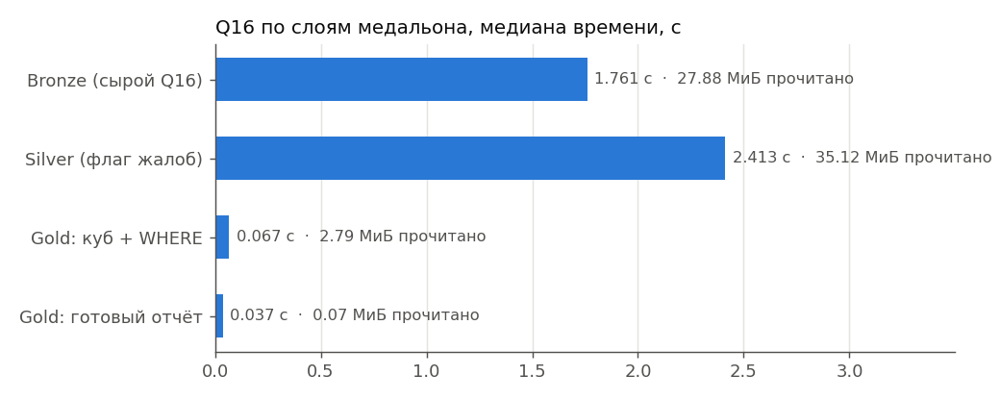

Ответ из Gold получается в **48 раз быстрее**, чем из сырого Bronze, и читает 0.07 МиБ вместо 27.88 МиБ: вся тяжёлая работа (джойн 8 000 000 строк, `count(DISTINCT)`) сделана один раз при построении витрины. Silver на этом запросе не быстрее Bronze (2.413 vs 1.761 с): Q16 и так читает только узкие колонки, а `LIKE` выполняется лишь по 100 тыс. поставщиков — выигрышу от очистки просто негде проявиться. Задача Silver — чистые и типизированные данные для всех витрин, а ускорение конкретного вопроса даёт Gold. Так и задумана медальонная архитектура: каждый следующий слой дороже построить, но дешевле читать.

### 3.5. Тесты производительности *(п. 5 формы)*

#### 3.5.1. Методика

1. **Что сравниваем:** 2 формата (`PARQUET`, `ORC`) × 4 кодека (`NONE`, `SNAPPY`, `GZIP`, `ZSTD`) = 8 вариантов.
   Кодек задаётся сессионным свойством Trino `bronze.compression_codec`, формат — свойством таблицы `format`.
2. **Как пересоздаём Bronze:** для каждого варианта три таблицы Bronze (`part`, `partsupp`, `supplier`) копируются
   `CREATE TABLE ... WITH (format = ...) AS SELECT * FROM bronze.lakehouse.<таблица>` в схему `bronze.bench`.
   Источник копии один и тот же (Parquet+ZSTD), поэтому в «время записи» входит одинаковое чтение источника +
   то, что отличается — кодирование, сжатие и выгрузка в MinIO. Генератор tpch сознательно не используем как
   источник: генерация данных «на лету» нагружает CPU и маскировала бы разницу между кодеками.
3. **Размер** — сумма `file_size_in_bytes` по `"<таблица>$files"` (только файлы данных, без метаданных Iceberg).
4. **Запросы:**
   * **Q16** — запрос варианта (джойн + `count(DISTINCT)` + `NOT IN`), читает 8 узких колонок из 21;
   * **full scan** — `count(*)`, `sum(length(ps_comment))`, `sum(ps_availqty*ps_supplycost)` по `partsupp`:
     читает все колонки, включая тяжёлый текст — показывает стоимость распаковки.
   Чтобы не мерить передачу 27 тыс. строк клиенту, запрос оборачивается в `SELECT count(*), sum(supplier_cnt) FROM (Q16)` —
   заодно это контрольная сумма: все 8 вариантов должны дать одинаковый ответ (проверено: ответ одинаковый во всех вариантах).
5. **Время** — серверное `end − created` из `system.runtime.queries` (не включает сеть до клиента).
   1 прогревочный прогон (JIT-компиляция, кэш метаданных) + **5 замеров**, берём **медиану** (устойчива к выбросам),
   приводим min–max и стандартное отклонение. Trino не кэширует данные между запросами, поэтому каждый замер
   реально читает файлы из MinIO.
6. Все замеры — на одном и том же стенде подряд, без другой нагрузки; Trino 476, Docker: 12 vCPU, 7.4 ГБ RAM.

#### 3.5.2. Таблица из формы (Parquet, Bronze)

| Сжатие на Bronze | Время запроса Q16 (медиана) | Размер Bronze, МБ | Время записи Bronze | Твой вывод (что лучше и почему) |
|---|---|---|---|---|
| GZIP | 1.617 с (min 1.516, max 1.961) | 295.78 | 49.73 с | Относительно ZSTD: размер меньше на 8.6 %, запись медленнее на 129 %, Q16 медленнее на 10 %, full scan медленнее на 28 %. Deflate — старый и медленный алгоритм: выигрыш в размере небольшой, а платим за него процессором при каждой записи и чтении. |
| ZSTD | 1.467 с (min 1.399, max 1.650) | 323.62 | 21.76 с | **Лучше ZSTD**: размер больше на 9 % (323.62 vs 295.78 МБ), при этом быстрее GZIP: запись, Q16, full scan. ZSTD — современный кодек (LZ77 + энтропийное кодирование FSE), быстро распаковывается; это кодек по умолчанию в Trino и Iceberg, выбран для всех слоёв. |

#### 3.5.3. Полный бенчмарк: 8 вариантов

| Формат | Кодек | Размер, МБ | Сжатие | Запись, с | Q16 медиана, с (min–max) | Q16 прочитано, МиБ | Full scan медиана, с (min–max) | Full scan CPU, с |
|---|---|---|---|---|---|---|---|---|
| PARQUET | NONE | 1242.00 | 1.00× | 27.86 | 3.185 (2.122–3.770) | 109.42 | 2.564 (1.854–3.909) | 7.05 |
| PARQUET | SNAPPY | 468.34 | 2.65× | 24.02 | 2.085 (1.768–2.180) | 56.01 | 1.768 (1.651–2.083) | 6.44 |
| PARQUET | GZIP | 295.78 | 4.20× | 49.73 | 1.617 (1.516–1.961) | 33.01 | 1.954 (1.906–2.189) | 7.00 |
| PARQUET | ZSTD | 323.62 | 3.84× | 21.76 | 1.467 (1.399–1.650) | 29.47 | 1.526 (1.424–1.544) | 6.04 |
| ORC | NONE | 1245.53 | 1.00× | 23.57 | 1.754 (1.516–3.207) | 49.34 | 1.187 (1.127–2.021) | 4.73 |
| ORC | SNAPPY | 446.27 | 2.79× | 19.70 | 1.450 (1.346–1.546) | 58.32 | 1.170 (1.010–1.470) | 6.08 |
| ORC | GZIP | 300.94 | 4.14× | 30.59 | 1.487 (1.431–1.645) | 44.93 | 1.453 (1.389–1.551) | 5.54 |
| ORC | ZSTD | 313.68 | 3.97× | 21.21 | 1.645 (1.554–1.812) | 52.17 | 1.120 (0.947–1.255) | 4.35 |

Сжатие — отношение к варианту без сжатия того же формата (`NONE`). «Прочитано» — сколько байт Trino реально
скачал из MinIO для Q16 (`physicalInputBytes`).

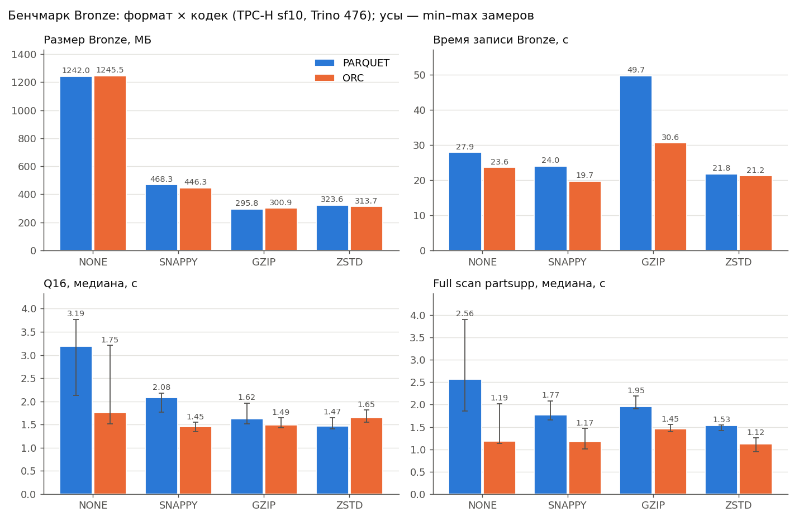

#### 3.5.4. Анализ

* **Размер.** Самый компактный вариант — **PARQUET+GZIP** (295.78 МБ), самый большой — ORC+NONE (1245.53 МБ): разница в **4.21 раза**.
* **Запись.** Быстрее всего пишется **ORC+SNAPPY** (19.70 с), медленнее всего — PARQUET+GZIP (49.73 с, на 152 % дольше).
* **Q16.** Лучшая медиана — **ORC+SNAPPY** (1.450 с), худшая — PARQUET+NONE (3.185 с), разброс 120 %. Разница больше разброса повторов, т.е. кодек заметно влияет на время Q16.
* **Full scan** (все колонки, включая текст) чувствительнее к кодеку: лучший — **ORC+ZSTD** (1.120 с), худший — PARQUET+NONE (2.564 с, +129 %).
* **PARQUET: ZSTD против NONE** — файлы в 3.84 раза меньше; Q16 быстрее на 54 %, прочитано 29.47 МиБ вместо 109.42 МиБ.
* **ORC: ZSTD против NONE** — файлы в 3.97 раза меньше; Q16 быстрее на 6 %, прочитано 52.17 МиБ вместо 49.34 МиБ.
* **Parquet vs ORC** (среднее по 4 кодекам): размер 582.43 vs 576.61 МБ (ORC меньше на 1 %), Q16 2.088 vs 1.584 с (ORC быстрее на 24 %).

**Почему так происходит (теория):**

* **Колоночный формат.** Q16 читает 8 колонок из 21; Parquet и ORC хранят колонки раздельно, и Trino скачивает
  только нужные — поэтому «прочитано» для Q16 в разы меньше размера таблицы, а full scan, которому нужны все
  колонки, заметно медленнее.
* **Кодеки.** `SNAPPY` и `ZSTD` (уровень 3 по умолчанию) — быстрые кодеки на основе LZ77, `ZSTD` дополнительно
  использует энтропийное кодирование (Huffman/FSE) и сжимает сильнее почти без потери скорости распаковки.
  `GZIP` (Deflate) обычно сжимает примерно как ZSTD, но и сжатие, и распаковка у него медленнее — это и
  проверяется временем записи и full scan в таблице выше. `NONE` даёт самые большие файлы: на локальном диске это почти не стоит времени,
  но в реальном объектном хранилище по сети (и за деньги за каждый ГБ) это самый дорогой вариант.
* **Числовые колонки** (ключи, количество) у Parquet/ORC уже сжаты кодированием (dictionary, RLE, delta) ещё до
  кодека, поэтому основной выигрыш кодека — на текстовых колонках `*_comment`, `p_name`.
* **Parquet vs ORC.** Оба колоночные с близкой степенью сжатия; Trino одинаково хорошо читает оба. Parquet выбран
  как основной, потому что это де-факто стандарт Iceberg и экосистемы (Spark, DuckDB, pandas, Superset-источники),
  а ORC исторически ближе к Hive.

**Итоговый выбор для слоёв:** чтобы выбор был не «на глаз», считаю взвешенную оценку (каждая метрика делится на лучшее значение среди 8 вариантов, меньше — лучше):

* **Bronze** (пишется один раз, хранится долго, читается редко — при пересчёте Silver): 0.5·размер + 0.25·запись + 0.25·full scan → лучший вариант **ORC+ZSTD**; PARQUET+ZSTD — на 2-м месте из 8.
* **Silver / Gold** (читаются постоянно аналитическими запросами): 0.5·Q16 + 0.3·full scan + 0.2·размер → лучший **ORC+ZSTD**; PARQUET+ZSTD — на 4-м месте.

**Вывод:** по формуле на этом стенде формально лучше ORC+ZSTD для Bronze и ORC+ZSTD для Silver/Gold. Сравнение ORC+ZSTD с PARQUET+ZSTD: размер 313.68 vs 323.62 МБ, запись 21.21 vs 21.76 с, full scan 1.120 vs 1.526 с, а **Q16 — целевой запрос варианта** — 1.645 vs 1.467 с (здесь Parquet+ZSTD быстрее). Разница по каждой метрике не больше 36 %, поэтому я оставляю **PARQUET + ZSTD**: Parquet — де-факто стандарт экосистемы Iceberg (его без настроек читают Spark, DuckDB, pandas, PyIceberg), а ZSTD — кодек по умолчанию в Trino и Iceberg, и на целевом запросе Q16 этот вариант быстрее. ORC+ZSTD — разумная альтернатива, если основная нагрузка — полные сканирования таблиц.

### 3.6. Часть 2 — осмысление и работа с инструментами *(п. 6 формы)*

#### 3.6.1. Понять и объяснить *(п. 6.1 формы)*

| Вопрос | Ответ |
|---|---|
| Зачем нужны большие данные и lakehouse (а не обычная БД/хранилище)? | Обычная OLTP-БД (PostgreSQL) хранит данные строками на дисках одного сервера: хранение и вычисления связаны, масштабируется дорого, аналитические запросы по сотням миллионов строк читают лишние колонки. Классическое DWH (Greenplum, Vertica) решает аналитику, но данные заперты в проприетарном формате одного движка и дорогом хранилище. Data lake (просто файлы в S3) дешёвый и бесконечный, но без транзакций, схемы и истории — «болото». **Lakehouse** объединяет плюсы: дешёвое объектное хранилище (MinIO/S3) + открытый табличный формат (Iceberg) с ACID-транзакциями, схемой, снапшотами и time travel + независимые движки (Trino, Spark), которые читают одни и те же таблицы. Хранение и вычисления масштабируются отдельно, нет vendor lock-in. В этой работе: 10 100 000 сырых строк хранятся в 319.14 МБ файлов в MinIO, и к ним одновременно ходят Trino и Superset. |
| Пример schema evolution на Silver: добавил/переименовал колонку — что произошло? | 1) `ADD COLUMN s_balance_segment varchar` выполнился за 0.03 с: Iceberg только записал новую версию схемы в `metadata.json`. Файлов данных до/после — 1/1 (ни один файл не переписан), у всех 100 000 строк в новой колонке `NULL`. 2) `UPDATE` заполнил колонку (0.76 с, это уже изменение данных → новый снапшот): DEBT — 9 006, HIGH — 45 660, LOW — 45 334. 3) `RENAME COLUMN ... TO s_acctbal_segment` — 0.03 с, тоже только метаданные: Iceberg идентифицирует колонки по **id**, а не по имени, поэтому старые parquet-файлы читаются под новым именем. Итог: 6 → 7 колонок (новая: `s_acctbal_segment`). Снапшот до изменений (`8427102042031398028`) по-прежнему читается через `FOR VERSION AS OF`: 100 000 строк, колонки: `s_suppkey, s_name, s_nationkey, s_acctbal, s_has_complaints, _bronze_ingested_at`. Gold не сломался (187 495 строк), снапшотов у таблицы всего: 3. |
| Пример скрипта восстановления данных из снапшота (time travel) | Сценарий на `silver.lakehouse.supplier`: было **100 000** строк → «ошибочный» `DELETE ... WHERE s_nationkey = 7` → **95 951** (потеряно 4 049). `FOR VERSION AS OF 8427102042031398028` показывает **100 000** — прошлое состояние доступно, потому что DELETE в Iceberg не стирает файлы, а создаёт новый снапшот (старые parquet-файлы остаются в MinIO). `ALTER TABLE ... EXECUTE rollback_to_snapshot(...)` вернул таблицу к **100 000** строкам за одну операцию с метаданными, без бэкапов и копирования данных (✅ проверено автоматически). Полный скрипт — `sql/05_time_travel.sql` (ниже). |

**Скрипт восстановления (time travel):**

```sql
-- 1. точка восстановления
SELECT snapshot_id FROM silver.lakehouse."supplier$history" WHERE is_current_ancestor ORDER BY made_current_at DESC LIMIT 1;
-- 2. «авария»
DELETE FROM silver.lakehouse.supplier WHERE s_nationkey = 7;
-- 3. читаем прошлое состояние (по id или по времени)
SELECT count(*) FROM silver.lakehouse.supplier FOR VERSION AS OF 8427102042031398028;
SELECT count(*) FROM silver.lakehouse.supplier FOR TIMESTAMP AS OF TIMESTAMP '2026-10-17 15:33:53 UTC';
-- 4. откат таблицы на снапшот
ALTER TABLE silver.lakehouse.supplier EXECUTE rollback_to_snapshot(8427102042031398028);
-- (вариант точечного восстановления только потерянных строк)
-- INSERT INTO silver.lakehouse.supplier
-- SELECT * FROM silver.lakehouse.supplier FOR VERSION AS OF 8427102042031398028 WHERE s_nationkey = 7;
```

История таблицы после сценария (`"supplier$history"`):

| made_current_at | snapshot_id | parent_id | is_current_ancestor |
|---|---|---|---|
| 2026-10-17 15:33:52.799 UTC | 8427102042031398028 | — | да |
| 2026-10-17 15:34:42.800 UTC | 5159160681522227162 | 8427102042031398028 | нет (откатили) |

**Скрипт schema evolution** — `sql/06_schema_evolution.sql`:

```sql
ALTER TABLE silver.lakehouse.supplier ADD COLUMN s_balance_segment varchar;          -- только метаданные
UPDATE silver.lakehouse.supplier SET s_balance_segment =
    CASE WHEN s_acctbal < 0 THEN 'DEBT' WHEN s_acctbal < 5000 THEN 'LOW' ELSE 'HIGH' END;  -- новый снапшот
ALTER TABLE silver.lakehouse.supplier RENAME COLUMN s_balance_segment TO s_acctbal_segment; -- только метаданные
SELECT * FROM silver.lakehouse.supplier FOR VERSION AS OF 8427102042031398028 LIMIT 1;  -- старая версия читается
```

#### 3.6.2. Подключить инструмент к lakehouse *(п. 6.2 формы)*

| Инструмент | Почему выбрал именно его |
|---|---|
| **Apache Superset 4.1** (BI) | Open-source BI, подключается к Trino через официальный SQLAlchemy-драйвер `trino` — то есть ко **всем трём слоям** сразу (одно подключение на каталог). Есть SQL Lab для ad-hoc запросов к сырому Bronze и дашборды для Gold, т.е. закрывает обе роли: «посмотреть сырые данные» и «отчёт для бизнеса». Подключается не к файлам напрямую, а через Trino + каталог Iceberg — значит видит актуальный снапшот, схему и права, как и любой другой потребитель lakehouse. Альтернативы: Metabase (для Trino нужен сторонний драйвер Starburst), StarRocks/Doris (движок, а не BI — для одного пользователя и sf10 избыточен, Trino уже справляется). |

**Скрипт развёртывания** — сервис `superset` в `docker-compose.yml` + `superset/Dockerfile`:

```dockerfile
FROM apache/superset:4.1.2
USER root
RUN pip install --no-cache-dir "trino[sqlalchemy]==0.340.0"   # драйвера Trino в базовом образе нет
USER superset
```

```bash
docker compose --profile bi up -d superset    # первый запуск ~2–3 мин: сборка образа, миграции, создание admin
# http://localhost:8088   логин admin / пароль admin
```

**Мои действия в UI** (скриншоты в `docs/screenshots/`):

1. `Settings → Database Connections → + Database → Trino`. SQLAlchemy URI:
   `trino://superset@trino:8080/bronze` (хост `trino` — имя контейнера в сети compose). `Test connection` → *Connection looks good!* → `Connect`.
   Так же добавлено подключение `trino://superset@trino:8080/gold`. — `07_superset_db.png`
2. `SQL → SQL Lab`, база *bronze*, схема `lakehouse`: в дереве слева видны таблицы `part`, `partsupp`, `supplier`
   (Superset получил их список у Trino, а Trino — у Lakekeeper). Выполнен запрос к **Bronze**:
   ```sql
   SELECT p_brand, count(*) AS parts, round(avg(p_retailprice), 2) AS avg_price
   FROM bronze.lakehouse.part
   GROUP BY p_brand ORDER BY p_brand;
   ```
   и запрос с time travel прямо из BI:
   ```sql
   SELECT snapshot_id, committed_at, operation, summary['added-records'] AS added
   FROM bronze.lakehouse."partsupp$snapshots";
   ```
   — `08_superset_sqllab_bronze.png`
3. В Trino UI (http://localhost:8080) видно, что эти запросы пришли от пользователя `superset` — `09_trino_ui.png`.
4. Дашборд по Gold: `Datasets → + Dataset → gold / lakehouse / q16_report` → чарт *Bar Chart*:
   X = `p_size`, метрика `SUM(supplier_cnt)`, разбивка по `p_brand` → дашборд «Q16: поставщики по размерам». — `10_superset_dashboard.png`

#### 3.6.3. Дополнительно: обслуживание таблиц и проблема мелких файлов

Bronze у нас append-only: в реальной системе загрузки идут часто, и **каждая порция — отдельный коммит Iceberg**:
новый снапшот, новый манифест и новый маленький файл. Чтобы показать, к чему это приводит и как лечится, раннер
(шаг `maintenance`, ручная версия — `sql/07_maintenance.sql`) загружает таблицу `supplier` в демо-таблицу
`bronze.lakehouse.maint_demo` **30 микро-порциями**, а затем выполняет `optimize` и `expire_snapshots`.
После каждого этапа замеряется состояние по метатаблицам и время одного и того же запроса
(`count(*)`, `sum(s_acctbal)`, `count(DISTINCT s_nationkey)`, медиана 5 замеров).

| Этап | Снапшотов | Файлов данных | Средний файл, КБ | Данные, КБ | Манифестов | Строк | Запрос, медиана с (min–max) | Время операции |
|---|---|---|---|---|---|---|---|---|
| После 30 микро-загрузок | 31 | 30 | 175.6 | 5268.0 | 30 | 100 000 | 0.127 (0.114–0.161) | — |
| После `optimize` | 32 | 1 | 5157.7 | 5157.7 | 31 | 100 000 | 0.106 (0.087–0.143) | 1.15 с |
| После `expire_snapshots` + `remove_orphan_files` | 1 | 1 | 5157.7 | 5157.7 | 31 | 100 000 | 0.095 (0.089–0.128) | 0.39 с |

* **Мелкие файлы.** 30 загрузок дали 30 файлов по ~176 КБ и 31 снапшотов — при рекомендуемом размере файла Iceberg 128–512 МБ. Каждый файл — это отдельный запрос к S3 и отдельный футер Parquet, который надо прочитать.
* **`optimize`** склеил их в 1 файл(а) за 1.15 с; запрос ускорился в 1.2 раза (0.127 → 0.106 с). Но снапшотов стало ещё больше (32), а старые мелкие файлы физически остались в MinIO — на них ссылаются старые снапшоты, поэтому time travel к первой загрузке ещё работает (3 333 строк).
* **`expire_snapshots`** оставил 1 снапшот(а) и удалил файлы, на которые больше никто не ссылается. Цена — история: time travel к первой загрузке теперь невозможен (Trino: «Iceberg snapshot ID does not exists: 3631120581839901438»).
* **Вывод:** append-only Bronze без регламентного обслуживания постепенно деградирует — файлов, снапшотов и метаданных становится всё больше, планирование и чтение замедляются. Компакцию и очистку снапшотов нужно запускать по расписанию, выбирая retention как баланс между местом и окном восстановления.

**Регламент для Bronze с частыми загрузками** (что я бы поставил в планировщик):

| Операция | Как часто | Зачем |
|---|---|---|
| `ALTER TABLE ... EXECUTE optimize` (по свежим партициям) | ежедневно | склеить мелкие файлы дня загрузки в крупные |
| `ALTER TABLE ... EXECUTE expire_snapshots(retention_threshold => '7d')` | ежедневно | удалить снапшоты старше 7 дней и их файлы; окно time travel — неделя |
| `ALTER TABLE ... EXECUTE remove_orphan_files(retention_threshold => '7d')` | еженедельно | убрать «осиротевшие» файлы после упавших записей |

Компромисс: чем короче retention, тем меньше места и метаданных, но тем короче окно для time travel и
восстановления (п. 3.6.1). В демо retention = 0 только для наглядности.

## ЗАКЛЮЧЕНИЕ *(п. 7 формы)*

В ходе работы поставленные задачи выполнены полностью. Основные выводы:

1. **Медальон** разделяет ответственность: Bronze хранит источник как есть (319.14 МБ, можно всё пересчитать), Silver — чистые типизированные данные без лишнего текста (в 3.0 раза меньше), Gold — готовый ответ на бизнес-вопрос, который читается в 48 раз быстрее сырого запроса.
2. **Хранение**: колоночный Parquet даёт Q16 читать только нужные 8 колонок из 21; партиционирование нужно только там, где оно отсекает много данных и не порождает мелкие файлы — на этом объёме это лишь партиция по дню загрузки в Bronze.
3. **Сжатие**: выбор кодека меняет размер Bronze до 4.2 раза, время записи — до 152 %, full scan — до 129 %. Для Q16 важнее всего **сжимать вообще**: без сжатия (PARQUET+NONE) запрос идёт 3.19 с и читает 109.42 МиБ, а со сжатием — 1.45–2.08 с: меньше байт нужно скачать из MinIO. Между самими кодеками разница по Q16 до 44 %, а сильнее всего кодек влияет на время записи и размер.
4. **Выбор PARQUET + ZSTD**: по размеру ZSTD больше GZIP (323.62 vs 295.78 МБ); по записи быстрее на 56 %, по full scan быстрее на 22 %; относительно несжатого Parquet экономит 74 % места (а значит, и трафика до S3). Место варианта в рейтинге по формуле — в п. 3.5.
5. **Lakehouse** (Iceberg поверх S3) дал то, чего нет у «просто файлов»: ACID-запись, time travel и откат за секунды, эволюцию схемы без перезаписи данных и доступ к одним таблицам из Trino и Superset.

---


## СПИСОК ЛИТЕРАТУРЫ

1. Trino 476 Documentation — Iceberg connector (table properties, time travel, `optimize`, `expire_snapshots`, метатаблицы). https://trino.io/docs/476/connector/iceberg.html
2. Trino Documentation — TPC-H connector. https://trino.io/docs/current/connector/tpch.html
3. Apache Iceberg — Table Spec (снапшоты, манифесты, schema evolution по id колонок). https://iceberg.apache.org/spec/
4. Apache Iceberg — Maintenance (expire snapshots, compaction, orphan files). https://iceberg.apache.org/docs/latest/maintenance/
5. Apache Iceberg — REST Catalog OpenAPI specification. https://github.com/apache/iceberg/blob/main/open-api/rest-catalog-open-api.yaml
6. Lakekeeper Documentation. https://docs.lakekeeper.io/
7. TPC Benchmark H Standard Specification (запрос Q16). https://www.tpc.org/tpch/
8. Apache Parquet — Documentation (колоночное хранение, кодирование, сжатие). https://parquet.apache.org/docs/
9. Apache ORC — Specification. https://orc.apache.org/specification/
10. RFC 8878 — Zstandard Compression. https://datatracker.ietf.org/doc/html/rfc8878
11. RFC 1951 — DEFLATE (основа GZIP). https://datatracker.ietf.org/doc/html/rfc1951
12. Armbrust M. et al. Lakehouse: A New Generation of Open Platforms that Unify Data Warehousing and Advanced Analytics. CIDR 2021. https://www.cidrdb.org/cidr2021/papers/cidr2021_paper17.pdf
13. Databricks — Medallion Architecture. https://www.databricks.com/glossary/medallion-architecture
14. Apache Superset — Connecting to Databases (Trino). https://superset.apache.org/docs/configuration/databases
15. Jacar — How to fix «pull access denied for minio/minio» (прекращение публикации образов MinIO, альтернативы). https://jacar.es/?p=7603
16. Гайды курса: «Локальный Lakehouse — пошаговый гайд», «Гайд 2. Медальонная архитектура: Bronze → Silver → Gold»; лекция «Р1. Развертывание локального Lakehouse». VK Education, НИТУ МИСИС, 2026.

## ПРИЛОЖЕНИЕ А. Скриншоты

**1. Стек поднят: контейнеры, инициализация бакетов и warehouse, каталоги Trino**

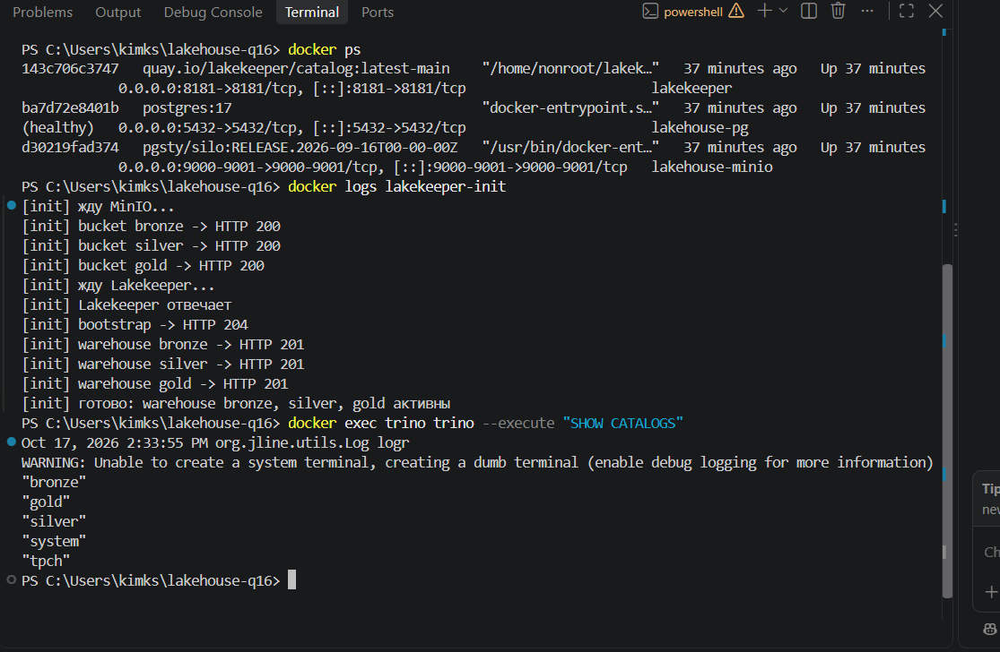

**2. MinIO (Silo): три бакета-слоя bronze / silver / gold**

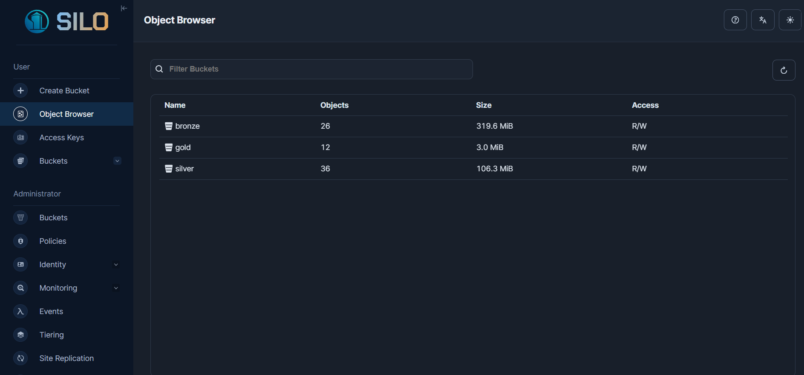

**3. Бакет bronze: папки таблиц Iceberg (data + metadata)**

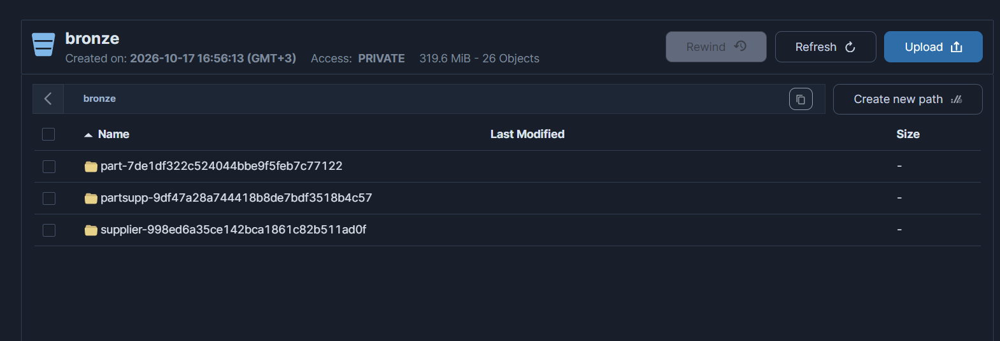

**4. Lakekeeper: 3 warehouse, 8 таблиц**

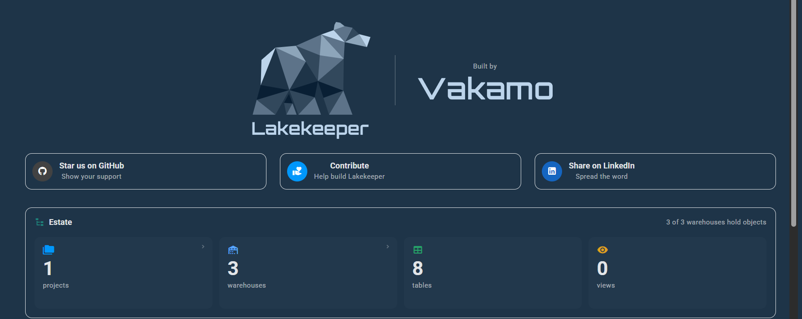

**5. Вывод раннера: бенчмарк 8 вариантов, time travel, schema evolution**

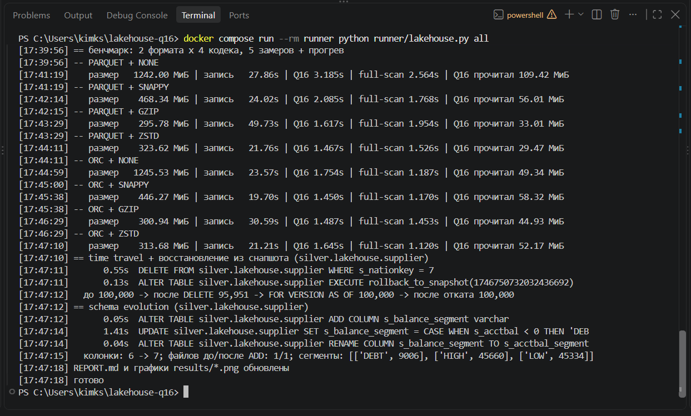

**6. Повторный прогон Silver / слоёв / time travel / evolution**

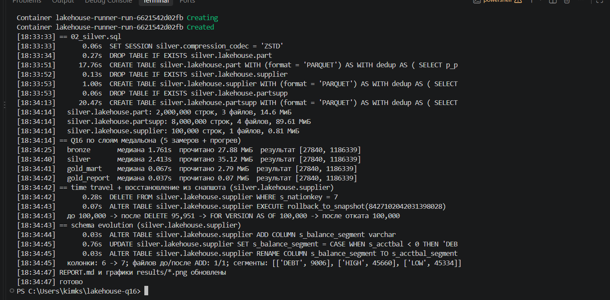

**7. Superset: подключения к каталогам bronze и gold через Trino**

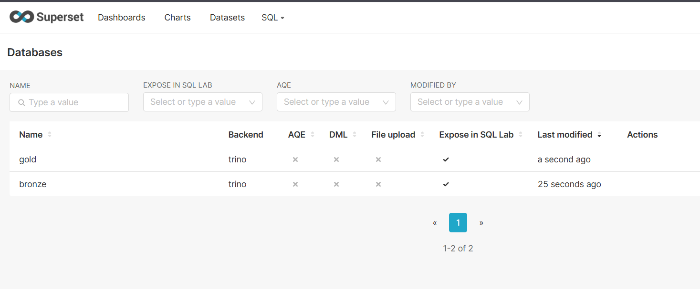

**8. Superset SQL Lab: запрос к Bronze**

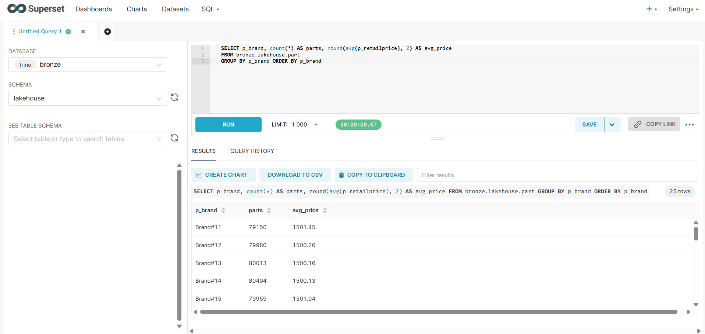

**9. Trino UI: запросы от пользователя superset (Apache Superset)**

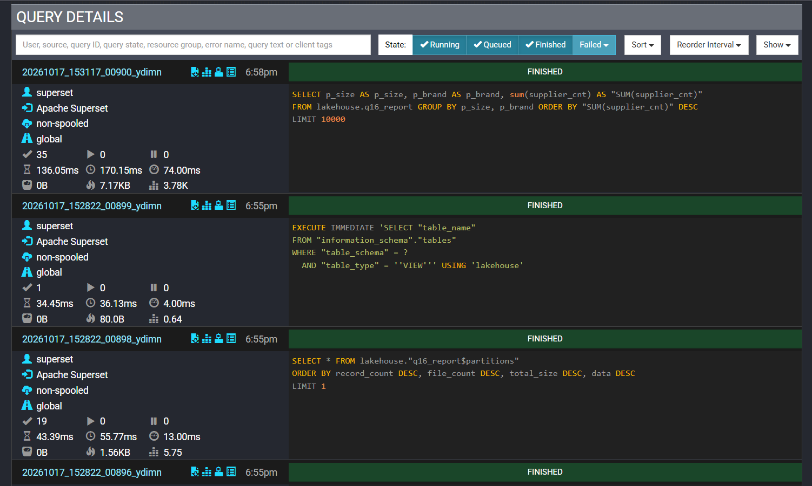

**10. Superset: дашборд по Gold (q16_report)**

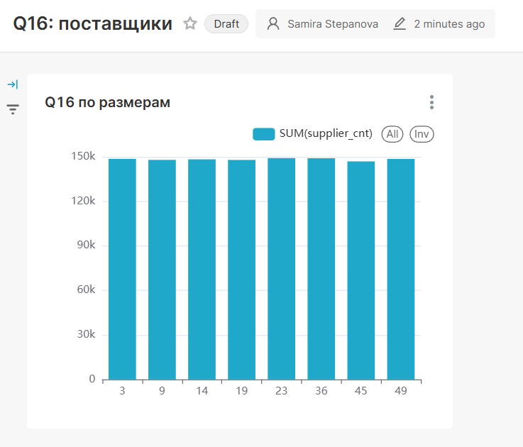

## ПРИЛОЖЕНИЕ Б. Структура репозитория

```
docker-compose.yml        весь стек одной командой
catalog/*.properties      каталоги Trino: bronze, silver, gold (Iceberg REST) + tpch (источник)
init/create-warehouses.sh регистрация 3 warehouse в Lakekeeper
sql/00..06_*.sql          схемы, Bronze, Silver, Gold, Q16, time travel, schema evolution
runner/lakehouse.py       пайплайн + проверки + бенчмарк (Python, trino-client)
runner/report.py          графики и заполнение REPORT.md из results/results.json
results/                  results.json, benchmark.csv, графики
superset/Dockerfile       Superset + драйвер Trino
docs/screenshots/         скриншоты UI
```
